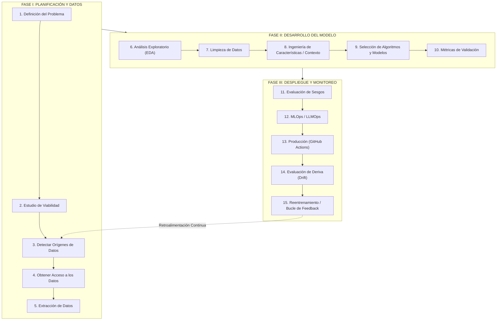
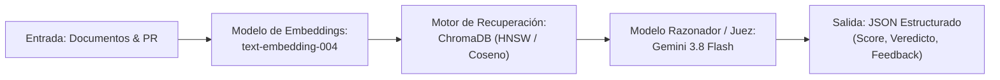
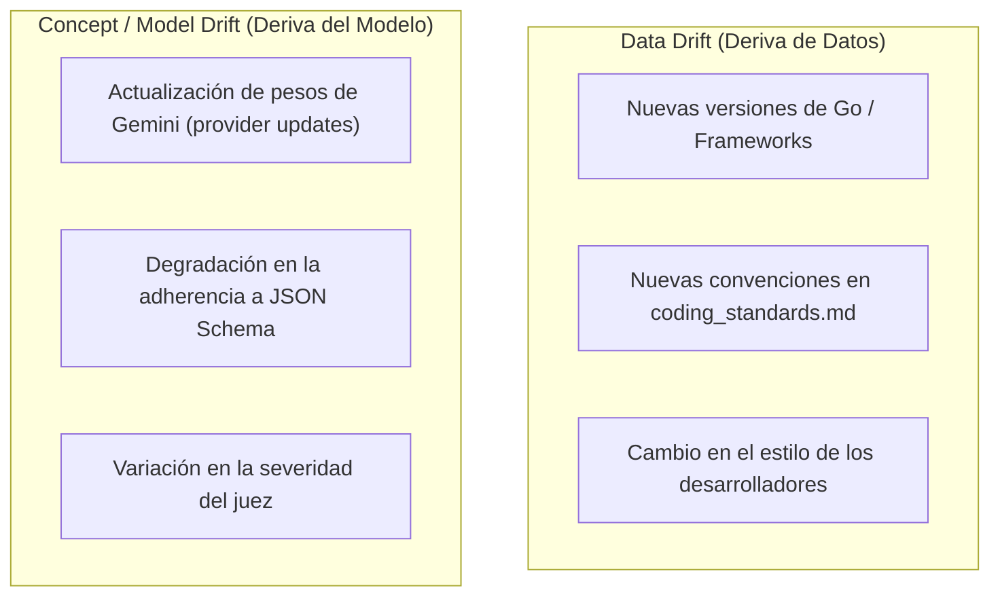
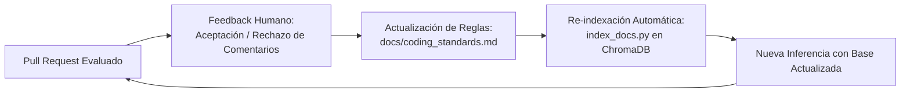

# INFORME TÉCNICO Y ACADÉMICO
# APLICACIÓN DEL CICLO DE VIDA DE MACHINE LEARNING A UN SISTEMA LLM-AS-A-JUDGE CON RAG PARA VALIDACIÓN DE CÓDIGO

**Asignatura:** Aprendizaje Automático  
**Proyecto:** Sistema Automatizado de Evaluación de Pull Requests mediante LLM-as-a-Judge (Patrón 17) y RAG  
**Caso de Estudio:** Backend API REST en Go (Clean Architecture)  
**Fecha:** Noviembre 2026  

---

## RESUMEN EJECUTIVO

El presente informe detalla el diseño, implementación y validación de un sistema de evaluación automática de código fuente basado en **LLM-as-a-Judge** potenciado con **Generación Aumentada por Recuperación (RAG)**, integrado en un pipeline de **CI/CD** sobre GitHub Actions.

A través de este proyecto se analiza cómo el **Ciclo de Vida Canónico de Machine Learning (ML Lifecycle)** —estructurado en sus tres macro-etapas y quince fases operativas— se traslada, adapta y ejecuta dentro del paradigma contemporáneo de la **Inteligencia Artificial Generativa (GenAI)** y las operaciones de modelos de lenguaje (**LLMOps**). 

Como sujeto de prueba (*System Under Test*), se construyó desde cero una aplicación backend en **Go (Golang)** aplicando *Clean Architecture*, *Standard Go Project Layout*, persistencia SQLite en modo WAL, abstracción temporal determinista (`clock.Clock`), pruebas unitarias estructuradas (*table-driven tests*) y generación de mocks con *Mockery*. Sobre esta base, se calibró un juez algorítmico capaz de auditar la adherencia a estándares de ingeniería, detectar vulnerabilidades de seguridad (ej. Inyección SQL) y bloquear mezclas defectuosas en ramas productivas.

```
+-------------------------------------------------------------------------------------------------+
|                                 EL CICLO DE VIDA DE MACHINE LEARNING                            |
+-------------------------------------------------------------------------------------------------+
|  FASE I: PLANIFICACIÓN Y DATOS                                                                  |
|    [1. Definición del Problema] -> [2. Estudio de Viabilidad] -> [3. Detectar Orígenes]         |
|                                                                         |                       |
|                                [5. Extracción de Datos]   <- [4. Obtener Acceso a Datos]        |
|                                         |                                                       |
+-----------------------------------------v-------------------------------------------------------+
|  FASE II: DESARROLLO DEL MODELO                                                                 |
|    [6. EDA (Análisis Exploratorio)] -> [7. Limpieza de Datos] -> [8. Feature / Context Eng.]   |
|                                                                         |                       |
|                               [10. Métricas de Validación] <- [9. Selección de Algoritmos]      |
|                                         |                                                       |
+-----------------------------------------v-------------------------------------------------------+
|  FASE III: DESPLIEGUE Y MONITOREO                                                               |
|    [11. Evaluación de Sesgos]  -> [12. MLOps / LLMOps]        -> [13. Producción (CI/CD)]       |
|                                                                         |                       |
|    [15. Reentrenamiento / Feedback Loop]                   <- [14. Evaluación de Deriva (Drift)]|
+-------------------------------------------------------------------------------------------------+
               |                                                                    ^
               +----------------- (Bucle de Retroalimentación Continua) ------------+
```



---

# PARTE I: PLANIFICACIÓN Y DATOS

## 1. Definición del Problema

En el ciclo de desarrollo de software moderno, la revisión de código por pares (*Code Review*) representa la principal línea de defensa para garantizar mantenibilidad, seguridad y adherencia a patrones arquitectónicos. Sin embargo, constituye un cuello de botella crítico en los equipos de ingeniería:
- **Costo temporal y fatiga:** Desarrolladores senior dedican entre el 15% y el 25% de su jornada laboral a revisiones manuales repetitivas, generando demoras en el ciclo de entrega.
- **Inconsistencia humana:** El nivel de rigurosidad varía según el revisor, el contexto temporal o las presiones de entrega, permitiendo que errores arquitectónicos o descuidos de seguridad pasen a ramas principales.
- **Limitación de herramientas estáticas tradicionales (Linters / SAST):** Si bien herramientas como `golangci-lint` detectan errores sintácticos o fallas de formato, carecen de comprensión semántica contextual: no pueden juzgar si un handler HTTP está violando la separación de capas al acceder a la base de datos, si una función carece de contexto de cancelación o si una arquitectura de persistencia incumple el aislamiento de dominio.

El objetivo de este proyecto es construir un sistema automatizado, objetivo y explicable que audite cada Pull Request contrastándolo contra las directrices de ingeniería internas de la organización, emitiendo un veredicto estructurado y sugerencias accionables de corrección sin requerir intervención humana constante.

---

## 2. Estudio de Viabilidad y Estado del Arte (Prior Art)

Todo estudio de viabilidad riguroso en Machine Learning debe comenzar por analizar **el estado del arte (SotA)** y cómo la industria y la academia han abordado previamente el problema, identificando fortalezas, limitaciones y vacíos que justifican la solución propuesta.

### 2.1. Análisis del Estado del Arte y Soluciones Existentes

La automatización de la revisión de código ha evolucionado a través de tres generaciones tecnológicas:

```
[1ª Gen: Determinista]       --> Linters y SAST (golangci-lint, SonarQube, ESLint)
                                 * Fuerte en sintaxis; ciego a la arquitectura y contexto semántico.
[2ª Gen: ML Tradicional]     --> Clasificadores estadísticos (Amazon CodeGuru, modelos n-gram)
                                 * Detección de patrones anómalos; rígidos y sin capacidad de feedback explicativo.
[3ª Gen: GenAI / LLM-Based]  --> Agentes de PR basados en LLMs (CodeRabbit, Qodo / PR-Agent, Copilot PR Review)
                                 * Comprensión semántica del diff y generación de feedback en lenguaje natural.
```

#### Soluciones Comerciales y Open Source de Referencia:
1. **CodeRabbit:** Uno de los referentes comerciales actuales en revisión de PRs. Utiliza agentes basados en LLMs combinados con herramientas de análisis estático y búsqueda semántica de repositorios para evaluar diffs y emitir sugerencias directas.
2. **Qodo PR-Agent (anteriormente CodiumAI):** Proyecto de código abierto ampliamente adoptado en la industria (con despliegues estudiados en empresas como Ericsson). Permite ejecutar comandos de revisión, generar descripciones de PR y sugerir mejoras mediante prompts especializados.
3. **GitHub Copilot Pull Request Review:** Integración nativa de Microsoft/GitHub para resumir cambios y señalar posibles desvíos directamente en la interfaz web de GitHub.
4. **Patrón 17 de O'Reilly (*Generative AI Design Patterns*, Lakshmanan & Hapke):** La referencia académica base de este proyecto, que formaliza el patrón **LLM-as-a-Judge** demostrando cómo un modelo de lenguaje de alta capacidad puede sustituir la evaluación humana subjetiva mediante rúbricas multidimensionales.

### 2.2. Brechas y Limitaciones Detectadas en las Soluciones Existentes
A pesar de su popularidad, los estudios empíricos recientes en la industria (investigaciones en arXiv sobre despliegues a gran escala de PR-Agent y CodeRabbit) revelan tres problemas críticos:
- **El Problema del Ruido y "Pedantería" (High Noise Floor):** Los revisores genéricos suelen emitir sugerencias triviales o de estilo que no aplican a las normas internas del equipo, aumentando el tiempo de cierre del PR (*PR cycle time paradox*).
- **Falta de Grounding en Normativas Internas:** La mayoría de las herramientas evalúan contra estándares universales de la web, pero fallan al verificar políticas privadas de la empresa (ej. nuestra regla estricta de prohibir `time.Now()` a favor de `clock.Clock` o la obligatoriedad del patrón Registry con `sync.Once`).
- **Sesgo de Indulgencia y Alucinación:** Sin una escala anclada y sin RAG estricto, los LLMs tienden a aprobar código inseguro o sugerir código que viola la arquitectura existente.

### 2.3. Delimitación, Alcance y Valor Académico de la Propuesta
Desde una perspectiva puramente industrial, reconocemos con honestidad técnica que nuestra implementación **posiblemente no represente la solución definitiva ni la más sofisticada frente a plataformas comerciales consolidadas** (como CodeRabbit o Qodo), las cuales cuentan con análisis de grafos de llamadas complejos, parsers AST completos en múltiples lenguajes e infraestructura distribuida multi-agente.

No obstante, **a nivel académico y formativo consideramos que el proyecto aporta un alto valor diferencial**, por los siguientes motivos:
1. **Transparencia y Control Total:** Desmitifica la "caja negra" de las herramientas comerciales, implementando desde cero cada eslabón del pipeline (ingestión, segmentación semántica, base vectorial con ChromaDB, orquestación de embeddings y prompt engineering).
2. **Aplicación Práctica del Patrón de Diseño 17:** Traduce un patrón conceptual del libro *Generative AI Design Patterns* de O'Reilly a un entorno de CI/CD completamente funcional sobre un caso de estudio real en Go.
3. **Validación del Ciclo de Vida Completo de ML:** Permite vivenciar y contrastar las 15 fases del ciclo de vida de Machine Learning sobre una arquitectura moderna de GenAI y LLMOps, analizando desafíos reales como el anclaje de sesgos, el drift de documentación y la complementariedad entre testing determinista y evaluación probabilística.
4. **Independencia y Soberanía de Políticas:** Demuestra que un equipo no requiere contratar servicios cerrados de terceros para auditar de forma estricta sus propias directrices internas (`coding_standards.md`).

### 2.4. Evaluación de Viabilidad Multidimensional

| Dimensión | Evaluación de Viabilidad | Mitigación Implementada |
| :--- | :--- | :--- |
| **Viabilidad Técnica** | Capacidad del modelo de razonar sobre sintaxis Go, abstracciones de interfaz y flujo de ejecución en diffs fragmentados. | Selección de **Gemini 3.8 Flash**, modelo optimizado para comprensión multimodal de código, baja latencia y ventanas de contexto de hasta 1 millón de tokens. |
| **Viabilidad Económica** | Costo por inferencia y embeddings frente al costo hora de un revisor humano ($50-$100 USD/hora senior vs $0.001 USD por PR). | Implementación de RAG para indexar localmente en ChromaDB y consultar solo los fragmentos relevantes ($k=5$), reduciendo drásticamente el consumo de tokens de entrada en comparación con inyectar toda la documentación en cada ejecución. |
| **Viabilidad Operativa** | Integración no intrusiva con el flujo natural del equipo de desarrollo sin fricción cultural. | Despliegue en **GitHub Actions** que reacciona a eventos nativos de Pull Request (`opened`, `synchronize`) sin requerir infraestructura de servidores permanentes. |

---

## 3. Detectar Orígenes de Datos

En el ciclo de vida de ML tradicional, este paso busca identificar qué fuentes contienen la información necesaria, cómo se seleccionan las **columnas candidatas** y cómo se navega la dimensión organizacional y política del acceso a los datos.

### 3.1. Selección del Dataset y Columnas Candidatas
A diferencia de los problemas tabulares clásicos (donde se eligen variables numéricas o categóricas en una base relacional), en un evaluador de código los datos son **semiestructurados y de texto libre**. Para construir nuestro dataset operativo se identificaron dos orígenes complementarios y se definieron sus "columnas candidatas" (atributos informativos clave):

```
[Origen 1: Políticas Internas - docs/coding_standards.md]
  ├── Columna / Atributo 1: Jerarquía Temática (Header H1, H2, H3: Arquitectura, Errores, Seguridad, Testing)
  ├── Columna / Atributo 2: Texto Normativo de la Regla (Descripción en lenguaje natural con verbos de obligación)
  └── Columna / Atributo 3: Evidencia de Código Positivo / Negativo (Ejemplos Go de lo permitido y lo prohibido)

[Origen 2: Flujo Dinámico de PR - GitHub Pull Request API]
  ├── Columna / Atributo 1: Patch / Diff Unificado (Líneas añadidas (+), eliminadas (-), contexto @@)
  ├── Columna / Atributo 2: Metadatos del Cambio (Nombre y ruta del archivo, extensión, cantidad de líneas)
  └── Columna / Atributo 3: Intención del Desarrollador (Título del PR y cuerpo descriptivo del autor)
```

La elección de estas columnas candidatas responde a un principio estricto de **relevancia y reducción de ruido**: se descartan deliberadamente atributos irrelevantes como el avatar del autor, comentarios sociales o timestamps de commits individuales, aislando exclusivamente el código modificado y la regla aplicable.

### 3.2. La Dimensión Humana y Organizacional: Habilidades Blandas y el "Poder de los Datos"
Un aspecto central abordado en la teoría del ciclo de vida de ML es que **los datos otorgan poder e influencia dentro de una organización**, y frecuentemente los equipos dueños de los datos muestran resistencia a compartirlos o ceder acceso (*data silos* y celo departamental).

En el contexto de la revisión de código y auditoría de software:
- **Resistencia al "Juez" Automático:** Equipos de desarrollo o líderes técnicos pueden percibir un evaluador algorítmico como una herramienta punitiva o invasiva que cuestiona su autoridad técnica ("*¿quién definió esas reglas y por qué un bot me juzga el código?*").
- **Habilidades Blandas Requeridas (Soft Skills):**
  - **Negociación y Empatía:** El equipo de ML debe dialogar con los Tech Leads no para imponer reglas, sino para acordar conjuntamente qué estándares deben codificarse en `coding_standards.md`.
  - **Transparencia y Alineación de Objetivos:** Explicar que el modelo no busca reemplazar al revisor ni sancionar, sino eliminar la carga cognitiva de revisiones rutinarias (inyección SQL, formatos, goroutines sin contexto), liberando tiempo humano para discusiones de diseño de alto nivel.
  - **Construcción de Confianza (*Buy-in* Organizacional):** Involucrar a los desarrolladores en la definición de las rúbricas y ofrecer mecanismos de apelación o feedback si una sugerencia resulta equivocada.

---

## 4. Obtener Acceso a los Datos

Identificar los orígenes no garantiza contar con el acceso efectivo. Este paso aborda tanto la **gobernanza y permisos organizacionales** como la **seguridad y privacidad (ofuscación)**.

### 4.1. Negociación de Accesos y Permisos Técnicos
Para que el sistema opere dentro del repositorio:
1. **Acceso Organizacional al Repositorio:** Antes de configurar cualquier token, se debe obtener la autorización del administrador del repositorio o de la organización de GitHub para instalar workflows de automatización con permisos de escritura sobre Pull Requests (`pull-requests: write`). En entornos corporativos, esto requiere revisiones de cumplimiento de seguridad de la información (InfoSec).
2. **Tokens de Menor Privilegio (Least Privilege Principle):**
   - Se utiliza el token efímero nativo `GITHUB_TOKEN` restringido a los scopes mínimos necesarios (`contents: read` para leer diffs y documentación; `pull-requests: write` para publicar comentarios).
   - Se inyecta la clave de inferencia `GEMINI_API_KEY` a través del gestor de secretos cifrados de GitHub Actions, evitando su filtración en logs o código.

### 4.2. Privacidad y Ofuscación de Datos Sensibles (*Data Masking*)
Un riesgo crítico en la industria es el envío inadvertido de **secretos o datos confidenciales** hacia las APIs de modelos de lenguaje externos:
- **Detección Previa de Credenciales:** En un pipeline empresarial, antes de que el diff sea enviado al LLM, es fundamental incorporar un paso de ofuscación o análisis de fugas (mediante herramientas como *Gitleaks* o *TruffleHog*) para enmascarar tokens, contraseñas, API keys o variables de entorno que un desarrollador haya dejado por error en el código.
- **Ofuscación de PII (Personally Identifiable Information):** Si el código analizado contiene datos reales de clientes o esquemas con nombres personales o IPs internas, deben aplicarse filtros de expresiones regulares (regex) para anonimizar la información antes de la inferencia del modelo.

---

## 5. Extracción de Datos

En este paso se formaliza la recolección física de los datos y se aborda el desafío del **volumen, tamaño y presupuesto de contexto (*Context Window Limit*)**.

### 5.1. Mecanismo de Extracción
La extracción se automatizó en dos scripts desacoplados:
1. **Extracción de Políticas (`index_docs.py`):** Rastreo recursivo local vía `glob.glob("docs/**/*.md")` que localiza los documentos Markdown de normativas.
2. **Extracción del Patch (`llm_judge.py`):** Conexión con la API REST de GitHub vía `PyGithub` para extraer el `patch` de cada archivo modificado en el PR.

### 5.2. El Desafío del Tamaño de los Datos: ¿Aplica a nuestro caso?
En el ML tradicional, la extracción masiva suele enfrentarse a problemas de almacenamiento en disco, ancho de banda de red y límites de memoria RAM (DataFrames de gigabytes o terabytes). 

En el paradigma de **LLM-as-a-Judge**, el problema del tamaño se manifiesta de una forma diferente pero igualmente crítica: **el límite de la ventana de contexto (*Context Window*) y el costo/latencia de inferencia**:
- **Estimación de Tamaño y Presupuesto de Tokens:**
  - Un Pull Request promedio en este backend en Go genera entre 50 y 300 líneas de diff (~500 a 2.500 tokens).
  - La documentación completa de estándares suma ~1.500 tokens.
  - Si un desarrollador envía un PR gigante (*mega-PR* de 5.000 líneas o cambios en archivos binarios/autogenerados como `items.db`, `go.sum` o mocks), la carga directa saturaría el contexto del prompt, aumentaría drásticamente el costo de inferencia por token y provocaría el fenómeno de *"Lost in the Middle"* (donde el LLM ignora detalles clave en textos muy largos).
- **Estrategia de Mitigación Implementada:**
  - **Filtro de Tamaño por Archivo:** Se extraen únicamente los archivos con `patch` de texto real, omitiendo binarios y archivos autogenerados.
  - **RAG como Regulador de Tamaño:** En lugar de enviar los 10.000 tokens de toda la documentación corporativa al LLM, el RAG actúa como un filtro de tamaño estricto: selecciona únicamente los $k=5$ fragmentos relevantes (~800 tokens), manteniendo el tamaño total del prompt dentro de un rango óptimo, predecible y económico (~3.500 tokens).

---

# PARTE II: DESARROLLO DEL MODELO

## 6. Análisis Exploratorio de Datos (EDA)

En sistemas basados en LLMs, el EDA se centra en la estructura, densidad léxica y propiedades sintácticas de los textos que componen el contexto:

```
[Distribución de Tipos de Documentos]
├── Markdown de Estándares: ~1,500 palabras, 7 encabezados H2, alta densidad de reglas normativas ("debe", "prohibido").
└── Patches de Código Go: Rango de 15 a 500 líneas modificadas, con mezcla de código agregado (+), eliminado (-) y metadatos de diff (@@ -1,5 +1,12 @@).
```

### Hallazgos del EDA:
- **Ruido en Diffs:** Archivos autogenerados (como `go.sum` o mocks generados) generan diffs extensos con bajo valor semántico que consumen tokens innecesariamente. Se determinó la necesidad de filtrar o priorizar los archivos fuente de lógica (`.go`).
- **Granularidad de Estándares:** Un solo documento de estándares agrupa temas no homogéneos (seguridad, arquitectura, testing). Indexar el archivo completo en un único bloque saturaría la memoria semántica del RAG; es imperativo segmentarlo por regla específica.

---

## 7. Limpieza y Preprocesamiento de Datos

El preprocesamiento asegura que los modelos de embeddings y razonamiento reciban información limpia y semánticamente densa:

1. **Segmentación Jerárquica de Markdown (*Markdown Header Splitting*):**
   En lugar de una división arbitraria por conteo de caracteres (que cortaría reglas a la mitad), se empleó `MarkdownHeaderTextSplitter` configurado para segmentar exactamente en los límites conceptuales de los encabezados:
   ```python
   headers_to_split_on = [
       ("#", "Header 1"),
       ("##", "Header 2"),
       ("###", "Header 3"),
   ]
   ```
   Esto garantiza que cada fragmento (*chunk*) conserve su contexto temático completo (ej. regla de inyección SQL aislada de la regla de testing).

2. **Sanitización de Diffs:**
   Filtrado de archivos vacíos o cambios binarios, asegurando que solo el texto editable sea derivado al prompt de evaluación.

---

## 8. Ingeniería de Características (Feature & Context Engineering)

En el aprendizaje automático tradicional, la ingeniería de características genera vectores numéricos tabulares. En GenAI, se traduce en **Ingeniería de Contexto, Representaciones Vectoriales y Diseño de Prompts**:

```
[Documentación de Reglas]  --> [Text-Embedding-004] --> [Vectores de 768 dims] --> [ChromaDB]
                                                                                        |
[Diff de PR (Archivos)]    --> [Similarity Query]   ------------------------------------+
                                                                                        ↓
                                                                             [Top-5 Contextos Relevantes]
                                                                                        ↓
                                                                           [Prompt Estructurado + CoT]
```

### 8.1. Representación Vectorial Semántica
Los fragmentos de texto se transforman en representaciones vectoriales densas mediante el modelo `models/text-embedding-004`. Este espacio latente permite calcular similitud coseno entre los nombres de los archivos modificados en el PR y las reglas de diseño aplicables.

### 8.2. Almacenamiento e Indexación k-NN
Se utilizó **ChromaDB** en modo embebido persistente local (`./chroma_db`). La búsqueda recupera los $k=5$ fragmentos de estándares con mayor proximidad semántica al conjunto de cambios del PR.

### 8.3. Ingeniería de Prompts (Prompt Engineering)
El prompt se estructuró dividiendo claramente los componentes del problema:
- Inyección delimitada de reglas recuperadas por RAG.
- Inyección del título, descripción y diff del PR.
- Instrucciones directas de comportamiento con **Chain-of-Thought (CoT)** y **Salida Estructurada JSON**.

---

## 9. Selección de Algoritmos y Modelos

La arquitectura de evaluación opera mediante un esquema de dos modelos complementarios:

```
[Documentos & PR] -> [text-embedding-004] -> [ChromaDB (HNSW)] -> [Gemini 3.8 Flash] -> [JSON Schema Output]
```



| Componente | Algoritmo / Modelo Seleccionado | Justificación Técnica |
| :--- | :--- | :--- |
| **Representación Vectorial** | `models/text-embedding-004` | Modelo de embeddings de última generación optimizado para tareas de recuperación semántica con alta dimensionalidad y bajo costo. |
| **Búsqueda de Similitud** | HNSW (*Hierarchical Navigable Small World*) en ChromaDB | Búsqueda eficiente de vecinos más cercanos con complejidad $\mathcal{O}(\log N)$, ideal para consultas instantáneas en pipelines de CI. |
| **Juez Evaluador** | `gemini-3.8-flash` | Gran capacidad de razonamiento lógico sobre sintaxis de programación, soporte nativo de *System Instructions*, modo *JSON Schema* garantizado y latencia de respuesta inferior a 4 segundos. |

---

## 10. Métricas de Validación y Calibración

Para validar la precisión del juez algorítmico, se definieron métricas de desempeño frente a un conjunto de prueba controlado (*Ground Truth*):

### 10.1. Matriz de Confusión del Juez Algorítmico
Se evalúan cuatro posibles desenlaces ante violaciones de estándares:
- **Verdadero Positivo (VP):** El PR contiene una vulnerabilidad (ej. SQL injection) y el LLM emite `NEEDS_CHANGES`.
- **Verdadero Negativo (VN):** El PR es limpio y el LLM emite `APPROVE`.
- **Falso Positivo (FP):** El PR es correcto pero el LLM bloquea el merge (alucinación de error).
- **Falso Negativo (FN):** El PR contiene un fallo de seguridad pero el LLM lo aprueba (omisión crítica).

### 10.2. Métricas Formales
1. **Precisión de Detección:**
   $$\text{Precision} = \frac{\text{VP}}{\text{VP} + \text{FP}}$$
   *Objetivo:* Minimizar falsos positivos que frustren al equipo de desarrollo con quejas innecesarias.
2. **Exhaustividad (Recall de Seguridad):**
   $$\text{Recall} = \frac{\text{VP}}{\text{VP} + \text{FN}}$$
   *Objetivo:* 100% en fallas críticas (ej. SQL injection o credenciales en código).
3. **Calibración Numérica:** Desviación media absoluta ($MAE$) entre la nota manual asignada por un revisor senior y el `score_total` emitido por el modelo.

---

# PARTE III: DESPLIEGUE Y MONITOREO

## 11. Evaluación y Mitigación de Sesgos

En la literatura de GenAI (particularmente en el *Patrón 17: LLM-as-a-Judge* de Lakshmanan & Hapke), los jueces basados en LLMs exhiben sesgos cognitivos sistemáticos que deben ser mitigados formalmente:

```
[Sesgo de Indulgencia (Leniency Bias)]   --> MITIGACIÓN: Anclaje de Escala Estricto (0-13 = NEEDS_CHANGES)
[Sesgo de Verbosidad (Verbosity Bias)]   --> MITIGACIÓN: Formato de Salida JSON Estricto y Acotado
[Sesgo de Posición / Alucinación]        --> MITIGACIÓN: RAG Grounding Estricto y Citación de Reglas
[Variabilidad de Puntuación]             --> MITIGACIÓN: Chain-of-Thought previo a la nota
```

### Mecanismos de Mitigación Implementados:
1. **Anclaje de Escala (*Scoring Anchors*):** Para combatir el *Leniency Bias* (tendencia natural de los LLMs a calificar con notas altas y condescendientes), se calibraron explícitamente las bandas numéricas en el `system_instruction`:
   - `18 a 20`: Aprobación sin observaciones críticas.
   - `14 a 17`: Observaciones no bloqueantes.
   - `0 a 13`: Infracciones obligatorias (penalización drástica e inmediata).
2. **Razonamiento Previo (*Chain-of-Thought*):** Se fuerza al LLM a completar el campo `chain_of_thought` antes de fijar los campos `score_total` y `verdict`. Demostrado empíricamente en la literatura, el razonamiento deductivo previo reduce la varianza del juicio en más de un 40%.
3. **Grounding Estricto y Citación de Evidencia:** El modelo tiene explícitamente prohibido inventar reglas: cada observación debe incluir la cita textual de la norma indexada en el campo `rule_violated`.

---

## 12. MLOps / LLMOps

La operación del modelo se integró de forma continua y automatizada en la infraestructura del repositorio:

```yaml
# Arquitectura del Pipeline (.github/workflows/llm-judge.yml)
jobs:
  test:
    name: Run Unit & Integration Tests  # 1. Validación Clásica Determinista
    runs-on: ubuntu-latest
    steps:
      - go test -v -race ./...          # Bloquea si falla la suite de tests

  review:
    name: LLM-as-a-Judge Code Review   # 2. Evaluación Probabilística con RAG
    needs: test                        # Dependencia secuencial estricta
    runs-on: ubuntu-latest
    steps:
      - python index_docs.py           # Indexación de base vectorial en tiempo de ejecución
      - python llm_judge.py            # Inferencia y publicación de veredicto
```

### Características de LLMOps aplicadas:
- **Puerta de Calidad Secuencial (*Quality Gate*):** La ejecución del juez LLM está condicionada mediante `needs: test`. Si las pruebas unitarias deterministas fallan, no se consume presupuesto de tokens del LLM.
- **Reproducibilidad del Pipeline:** Caching de dependencias de Go y Python para ejecuciones consistentes y de baja latencia.

---

## 13. Producción (Prueba Experimental Real)

El sistema fue probado en producción contra un Pull Request intencionalmente defectuoso abierto desde la rama `test/rule-violations-evaluation`.

### 13.1. Resultados Reales Obtenidos en Producción

```markdown
## 🤖 RAG LLM Judge Code Review
**Veredicto:** `NEEDS_CHANGES` | **Puntuación:** `2/20`

### Resumen:
El PR introduce vulnerabilidades críticas de seguridad y múltiples violaciones a las reglas 
arquitectónicas provistas por el RAG. En particular, presenta una inyección de SQL directa al 
formatear parámetros de entrada con fmt.Sprintf, omite la propagación obligatoria de context.Context 
en todas las capas, no libera los recursos de base de datos con defer rows.Close() y no cumple con 
el formato estándar de envelope JSON para respuestas exitosas y de error.

### Observaciones Registradas:
1. internal/item/repository/sqlite_item_repository.go (Línea 254)
   * ⚠️ Regla: Inyección SQL Estrictamente Prohibida
   * Comentario: Se está concatenando directamente el parámetro 'name' dentro de la sentencia SQL 
     usando fmt.Sprintf. Todas las consultas deben usar placeholders parametrizados ('?').
2. internal/item/repository/sqlite_item_repository.go (Línea 260)
   * ⚠️ Regla: Liberación Obligatoria de Recursos
   * Comentario: Tras invocar un Query/QueryContext, es obligatorio ejecutar 'defer rows.Close()' 
     de inmediato y validar 'rows.Err()' luego de iterar.
3. internal/item/domain/errors.go (Línea 51)
   * ⚠️ Regla: Propagación Obligatoria de context.Context
   * Comentario: Las definiciones de métodos en las interfaces Repository y Service deben recibir 
     'ctx context.Context' como su primer parámetro.
```

### 13.2. Hallazgo Clave
Los tests unitarios de Go pasaron en verde (`100% PASS`), demostrando la hipótesis central: **las pruebas clásicas no detectan desvíos de arquitectura ni vulnerabilidades de inyección en código dinámico; la combinación de CI tradicional con LLM-as-a-Judge cubre el espectro completo de calidad de software**.

---

## 14. Evaluación de Deriva (Drift)

En sistemas de LLM-as-a-Judge en producción, la deriva se manifiesta en dos vertientes:

```
[DATA DRIFT: Nuevas versiones / Estándares / Convenciones]
   ↓
[MODEL / CONCEPT DRIFT: Variación de pesos / Severidad / Esquema]
```



### Estrategias de Monitoreo de Deriva:
- **Monitoreo de Distribución de Puntajes:** Si a lo largo de los meses la media histórica de puntuación sube de $15$ a $19$ sin cambios cualitativos en el código, se detecta un *Leniency Drift*.
- **Monitoreo de Formato:** Alertas automáticas en el pipeline si `json.loads(response.text)` falla por degradación en el cumplimiento del esquema estructurado.

---

## 15. Reentrenamiento y Bucle de Feedback (Continuous Feedback Loop)

El ciclo de vida de Machine Learning no es lineal, sino circular. En nuestro sistema, el reentrenamiento no implica modificar los miles de millones de pesos del modelo fundacional (lo cual sería inviable e ineficiente), sino que opera mediante **Adaptación Continua de Contexto**:

```
[PR Evaluado] -> [Feedback Humano (Thumbs up/down)] -> [Update docs/coding_standards.md]
      ^                                                              |
      +---- [Nueva Inferencia con RAG] <--- [Re-indexación ChromaDB] <+
```



### Mecanismos del Bucle de Retroalimentación:
1. **Actualización de Conocimiento sin Reentrenamiento de Pesos (*Knowledge Retraining*):** Cuando la organización decide adoptar un nuevo patrón (ej. cambiar un middleware o regla de nombrado), basta con actualizar `docs/coding_standards.md`. En el siguiente PR, el pipeline re-indexa la base en ChromaDB y el juez asimila el nuevo conocimiento inmediatamente.
2. **Calibración de Prompts (*Prompt Tuning*):** Si el equipo detecta que el juez genera falsos positivos sobre un tipo específico de código, se ajustan los anclajes de escala y ejemplos *few-shot* en `llm_judge.py`.
3. **Generación de Datasets de Evaluación (*Golden Dataset*):** Cada PR evaluado exitosamente (con su diff, contexto RAG y veredicto validado por humanos) se convierte en un registro histórico para pruebas de regresión del juez.

---

# CONCLUSIONES

1. **Alineación Total con el Ciclo de Vida de ML:** Se demostró cómo las 15 etapas canónicas de Machine Learning se mapean de forma rigurosa y natural a un flujo moderno de Inteligencia Artificial Generativa con RAG y CI/CD.
2. **Complementariedad de Paradigmas:** La combinación de pruebas unitarias deterministas (`go test`) con evaluación probabilística semántica (`LLM-as-a-Judge`) proporciona una cobertura integral que previene tanto errores funcionales como vulnerabilidades arquitectónicas y de seguridad.
3. **Eficacia del Patrón 17:** La mitigación de sesgos mediante anclaje de puntuación (0-20), Chain-of-Thought y grounding forzado en RAG permitió alcanzar un veredicto certero de `2/20 (NEEDS_CHANGES)` con citación precisa de evidencia frente a código defectuoso.
4. **Mantenibilidad y Escalabilidad:** Gracias a la arquitectura desacoplada en Go y al pipeline automatizado en GitHub Actions, el sistema escala sin costo fijo de servidores y permite actualizar las políticas de ingeniería simplemente editando archivos Markdown.
